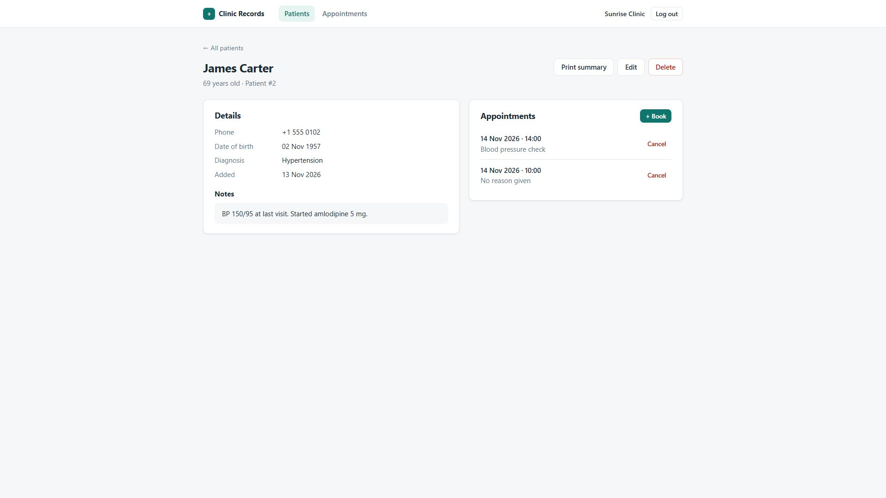
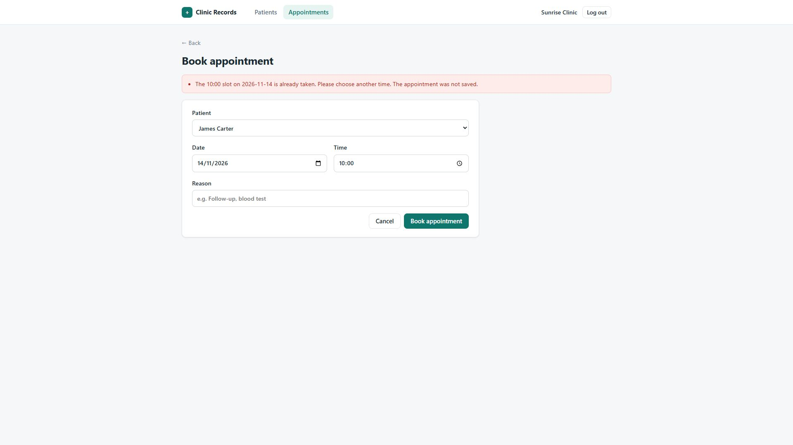

# Evidence 002: two patients could be booked into the same slot

**Status: ✅ fixed and re-checked by Kane CLI** (Nov 13, 2026). Everything was done **through
the Bug Whisperer website**: the report form, the live view and the "Fix it" button.

| | Before | After |
|---|---|---|
| Kane's screen |  |  |
| | James Carter booked at 10:00 tomorrow, with Aisha already in that slot. No error | "The 10:00 slot … is already taken. The appointment was not saved." |

## The report, as written

> we have 2 patients booked at 10:00 tomorrow?? how did the system allow that. sunrise clinic. the 2nd one should be blocked

Kane's own failure title: **"Duplicate appointment slot is accepted"**.

## What happened, including what went wrong

| Step | Result |
|---|---|
| Reproduce ([reproduce-1.ndjson](reproduce-1.ndjson)) | 🐛 Reproduced on the first try: Kane booked Aisha, then James, at 10:00 tomorrow, and the app saved both |
| Fix run 1 (3 attempts) | ❌ **Not proven, and the bug was Bug Whisperer's, not the fix's.** The fixer's code was right, but the clinic app's auto-reload (uvicorn on Windows) hung after the first change, so Kane kept testing the old code. Kane's evidence showed the same `POST /appointments/new → 303` every time, which is how we found it. After 3 attempts the loop stopped and asked for a person, as designed |
| What we changed in Bug Whisperer | It now restarts the app itself after every fix (no auto-reload) and resets the test data (`seed.py`) before every Kane run, so the reproduction and the re-check start from the same state. The clinic code was put back to before run 1 |
| Fix run 2 | ✅ **Proven on attempt 1**: same objective, Kane passed |

The first run is kept on record in [investigation.json](investigation.json) (`fix_history`), with
a note. Its Kane logs are [verify-2.ndjson](verify-2.ndjson) and
[verify-3.ndjson](verify-3.ndjson). Run 2's re-check overwrote run 1's `verify-1.ndjson`, because
both used the same file name. Since then each fix run writes its own files
(`verify-<run>-<attempt>.ndjson`).

## The regression test

`.testmuai/tests/bug-20261113-124324-d930-fixed-date_test.md`, with secrets removed.

**Re-recorded the same day (Nov 13), and why.** The original passing run booked "tomorrow", and
Kane recorded the date it actually typed: 2026-11-14. A day later that date is in the past, so
a replay would hit the (correct) past-date error from case 001 instead, and fail even though
double booking is still fixed. The hook could then block Claude for no reason. So we ran the same
check with a fixed date a year ahead (**2027-11-14**). Kane passed on the fixed code
([rerecord-fixed-date.ndjson](rerecord-fixed-date.ndjson), 138 s), and that run replaced the old
test. The planner now always writes exact, far-future dates, so new cases don't have this
problem.
